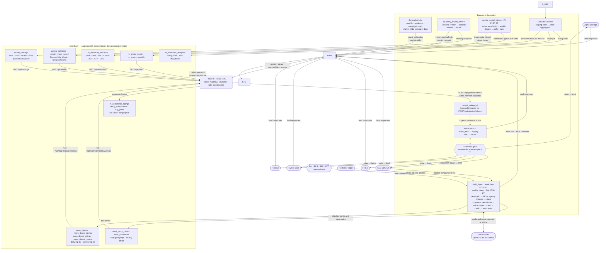

# Data Architecture
---
## Persistent Data
*Refreshed daily via scheduled Dagster jobs, independent of ticker activity.*

- **Commodities** — one table, key `(nominal, date)` — gold/silver spot prices (monthly)
- **Market indexes** — `raw_fred_market`, key `(series, date)` — CBOE VIX (`VIXCLS`, full history) and S&P 500 price index (`SP500`, ~10y daily per S&P licensing), landed daily from FRED; typed in `stg_fred_market`, aggregated into `m_fred_market` (levels + close-to-close momentum over 5/21/63/126/252d). Serves the ML model datasets as point-in-time market-regime features (daily)
- **Macro indicators** — one table, key `(indicator, date)` — CPI, unemployment, fed funds, natural gas, inflation, real GDP (one row per indicator/date rather than a separate table per series) (monthly)
- **Top Gainers/Losers** — own table, key `(ticker, date, bucket)`; `date` is the session the list describes (Alpha Vantage's `last_updated`), never the fetch date (overnight: 00:30 ET Tue–Sat, since the free tier publishes a session late that evening)
- **IPO Calendar** — own table, key `(symbol, date)` (weekdays)
- **Earnings Calendar** — own table, key `(symbol, quarter, year)` (weekdays)
- **Market News (articles)** — `raw_news_articles`, key `article_id` (hash of URL) — title, summary, source, time_published, plus `provider` and `feed`. Finnhub general news (older Alpha Vantage rows also carry overall_sentiment_score), pulled 7am + 7pm ET plus the overnight daily run; served via SQL `WHERE` + `LIMIT/OFFSET` with headline/date filters so paging never loads the full table. The digest jobs land the primary sources here too, in the same shape: SEC 8-Ks (`provider` `sec_edgar`, `feed` `sec_8k`, with the filing's `items`) and government releases (`provider` `agencies`, `feed` `fed` / `bls` / `sec_press` / `ftc`).
- **SEC 8-Ks** — endpoint `sec_8k_releases` (`ingest.sec_filings`), chained into both digest jobs, no TTL (a filing never changes). The tracked companies' (tickers with prices) 8-Ks since the pull cursor (watermark `(sec_8k_releases, cursor)`: the newest acceptance time read, held back before any filing that failed), from EDGAR's latest-filings feed, the daily form index when the cursor is older than the feed reaches. One article per accession: the press release (EX-99.1), else the 8-K itself; 8-K/A, routine items (vote results, bylaws, financings, exhibits only) and a 7.01/8.01 with no release are skipped. `SEC_USER_AGENT`, at most 5 requests a second; the first run looks back 36h.
- **SEC ticker list** — `raw_sec_company_tickers`, endpoint `sec_company_tickers`, one snapshot watermark, TTL 7 days — SEC's ticker → CIK map, refreshed by the digest jobs before the 8-K pull.
- **Government releases** — endpoint `agency_releases` (`ingest.agency_feeds`), chained into both digest jobs, no TTL. The Federal Reserve's monetary releases, BLS's headline numbers (`bls_latest.rss`: a new figure for a new period is a release; the first run lands the figures already out undated, as a baseline), SEC press releases and FTC competition releases. Each site's robots.txt is obeyed with the scraper's rules; a feed that fails is skipped for that run. An SEC or FTC release whose title names a tracked company gets its tickers.
- **Market News (ticker links)** — `news_ticker_sentiment`, key `(article_id, ticker)` — from Finnhub's `related` field (older Alpha Vantage rows also carry relevance_score, ticker_sentiment_score), the filer of an 8-K, or the companies an agency release names. This junction table is what makes news joinable to a ticker, since one article can mention several tickers and one ticker appears in many articles.
- **News (staged)** — `staging.stg_news_articles`, key `article_id` — one typed row per article from any provider: `published_at` as a UTC timestamp, outlet, headline, summary, url, `feed`, `items` (an 8-K's items) and `tickers` (most relevant first: Finnhub's `related` order, Alpha Vantage tickers with relevance ≥ 0.5). Incremental: each run restages the articles landed since the newest staged `fetched_at`; a table staged before `feed` existed is restaged in full.
- **News digests** — `mart.news_digests` (one row per digest: window, release counts, how much market news was filtered out, the S&P 500's move and the VIX), `mart.news_digest_stories` (the top stories with each score input), `mart.news_digest_articles` (which releases were grouped under each story) and `mart.news_digest_context` (the most covered market headlines), all keyed by `(period, digest_date)`. `daily`: built at 07:30 ET on weekdays from the 24h to 07:00 ET (Monday's covers the weekend), top 10. `weekly`: dated by the week's Friday, built Saturday 07:30 ET from the seven days to 07:00 that morning, top 15. Rule-based, no model. Stories come from the primary sources only: group releases about the same event, then score 0.40 event (what the 8-K items or the kind of release say happened) + 0.25 reaction (how the lead stock moved on the day or over the week; the S&P 500's move for a market-wide Fed or BLS release) + 0.20 size (the lead stock's market cap, log scale from $10bn to $1tn; full for a market-wide release) + 0.15 on-site (the stock is in one of the site's rankings). A story needs 0.20 to be picked, so a quiet day has fewer; a daily digest keeps up to 2 of its 10 places for policy or macro stories scoring at least 0.30. Finnhub's general headlines are never stories: with routine items and commentary dropped and repeats grouped, the most covered 5 a day (10 a week) go to `news_digest_context` for the summaries' market paragraph. Digests built from the news feed before this keep their coverage and category inputs. A rebuild replaces that digest's rows.
- **Article pages** — `raw.news_article_pages`, key `url` — the publisher page behind each story a digest picked (HTML, HTTP status, robots.txt verdict, attempts), fetched inside the digest jobs with robots.txt and AI-crawler opt-outs obeyed; a success, a refusal or a block is final, a timeout or 5xx is retried after 6 hours, at most 3 times. NEWS_SUMMARIES.md is the spec.
- **Article text** — `staging.stg_news_article_text`, key `url` — each page's main text (forms and pop-ups removed, trafilatura), first 1,500 words kept, with the whole article's word count. Re-extracted only when the extractor changes.
- **Story cards** — `mart.news_story_cards`, key `story_key` (the lead article's id) — one fact card per picked story (what happened, companies and tickers, government bodies, figures, why it matters), written by the local model (Qwen3.5-4B on Ollama) from the article text and checked: every number must be in what the model was given, every ticker in the story or the article. A card that fails twice, or a story with no readable article, gets the feed summary's opening instead (`fallback`). Stories that share an article (Tuesday's story picked again for the week) share their cards.
- **News summaries** — `mart.news_summaries`, key `(period, digest_date, part)` — the daily paragraph (part 0) and the weekly article (part 0 the overview, then one row per section), written by the local model from the cards and checked for numbers, tickers, length and advice wording. A part that fails twice is stored as `sources_only`, with no text. NEWS_SUMMARIES.md is the spec.
---
## Real-Time / Ticker-Partitioned Data
*Fetched on-demand per ticker via dynamic partitions, gated by a staleness check against `last_updated`.*

- **Prices (Daily)** — one table, key `(ticker, date)`. Sourced from **Twelve Data** `time_series` (`interval=1day`, `adjust=splits`) — split-adjusted to keep historical closes comparable across split events (e.g. a 4-for-1 split shouldn't make older closes look artificially high relative to current price). Weekly/monthly are derived downstream via resampling, not fetched separately.
- **Quote** — own table or cache, key `(ticker)`. Finnhub quote, hot path with cache TTL ~1 min.
- **Company Profile 2** — own table, key `(ticker)` with `last_updated`, snapshot-style (latest row only). TTL: 3 days.
- **Basic Financials** — own table, key `(ticker, quarter, year)` with `last_updated`. TTL: 3 days.
- **Financials As Reported** — own table, key `(ticker, quarter, year)` with `last_updated`. Staleness check counts from the newest held filing's own period end (`endDate`) — refetch only once the next 10-Q's filing window has closed (two quarters out after a fiscal Q3, since Q4 is reported on the 10-K), not on a fixed 7-day clock or by matching fiscal labels to calendar quarters. XBRL tag normalization (Finnhub's raw XBRL tags → canonical metric names, e.g. `Assets` → `totalAssets`, via alias/prefix matching) happens in the mart scoring layer with fallback/coalesce logic per canonical metric, since tag names aren't standardized across companies.
- **SEC Balance Sheets** — `raw_sec_balance_sheets`, key `(ticker, accession_number)`. SEC EDGAR `companyfacts`, free and keyless. Fills balance sheets Finnhub serves empty: no TTL (a filing never changes); fetched only when Finnhub has landed a filing with an empty balance sheet since the ticker's last SEC fetch, so a ticker with complete filings never makes the call. Only the last three years of filings are landed. `stg_financials_reported` merges the two sources on accession number (`bs_source` = `finnhub` / `sec`), and the dataset builder and fair value read that table, not raw. A refetch from Finnhub also never replaces a filled statement with an empty one for the same filing.
- **EPS Surprises** — own table, key `(ticker, quarter, year)` with `last_updated`. TTL: 30 days.
- **Earnings Call Transcript** — own table, key `(ticker, quarter, year, speaker_sequence)` — one row per speaker segment, not one row per call. Effectively immutable once published — fetch once per quarter, never refetch.
- **Insider Sentiment** — own table, key `(ticker, year, month)` with `last_updated`. TTL: refetch only if current month has no row.
- **Recommendation Trends** — own table, key `(ticker, period)` with `last_updated`. TTL: 30 days.
- **Peers** — own table, key `(ticker)` with `last_updated`. TTL: 60 days.
- **Technical Indicators** (SMA, EMA, MACD, RSI, STOCH, ADX, CCI, AD, OBV, BBANDS, ATR) — table `m_technical_indicators`, key `(ticker, date)`, computed from the cleaned daily bars via a downstream Dagster asset. No API call involved — this is pure derivation, refreshed whenever new daily bars land, not on the API-staleness clock. Aggregations live in the mart layer, not staging.
- **Advanced Analytics** — Scalar stats (MIN, MAX, MEAN, VARIANCE, STDDEV, MAX_DRAWDOWN), table `m_advanced_analytics`, key `(ticker, date)`, computed from the cleaned daily bars via a downstream Dagster asset. No API call involved — this is pure derivation, refreshed whenever new daily bars land, not on the API-staleness clock.
---
### API Calling
`Push Advanced Analytics and Technical Indicators to be pipelined derivations rather than API calls.`

Monthly: Commodities (AV), Macro indicators (AV), Stock Symbol (FH)
Weekly: n/a
Weekdays: IPO Calendar (FH), Earnings Calendar (FH), Top Gainers/Losers (AV)
Daily: Market News (FH), Market Indexes (FRED)

On Stock Lookup (Everytime): Quote (FH), Time Series (TD)
On Stock Lookup (If stale): Company Profile 2 (FH), Basic Financials (FH), Financials As Reported (FH), Insider Sentiment (FH), Recommendation Trends (FH), EPS Surprises (FH), Peers (FH), Earnings Call Transcript (AV)
On Stock Lookup (If Finnhub left a gap): SEC Balance Sheets (SEC EDGAR)

---
## Data Flow Diagram

> Notes on the loop:
> - The unprefixed mart objects the UI reads (`confidence_ratings`,
>   `category_scores`, `buy_plans`, `rating_components`) are **presentation
>   views** over the `m_*` snapshot tables — they rename storage columns to
>   the read contract (`computed_at → as_of`, `rating → UPPER_SNAKE advice`,
>   `stop_loss → stop_loss_price`) and join the company profile for name/logo.
>   `mart.model_weights` is seeded from the scoring module's weight spec at
>   schema init, so displayed weights can't drift from applied weights.
> - The quote path is **not** a direct frontend→Finnhub call — the UI reads
>   `raw.raw_quotes` from the warehouse; a refresh run updates it (TTL ~1 min)
>   whenever the ticker is recomputed.
> - Snapshot freshness: a search for a ticker with an existing rating serves
>   the mart snapshot immediately when fresh (younger than 1 day). A stale
>   snapshot is still served (source="refreshing" in the UI) while a refresh
>   job is launched; a ticker with no snapshot launches a job and reports
>   source="pending" until the mart snapshot lands.
> - Push model, no sensors: compute requests launch the `refresh_tickers` job
>   directly over GraphQL (`POST /api/pipeline/refresh`, per-ticker cooldown
>   dedups the UI's poll loop). The legacy `control.ticker_requests` queue
>   tables still exist but nothing consumes them.
> - Scheduled jobs and on-demand runs are independent: schedules warm the
>   persistent universe (news, calendars, movers, macro); on-demand runs
>   compute per-ticker ratings. The quarterly `quarterly_model_refresh` job
>   additionally refreshes every ticker in the warehouse, rebuilds the training dataset,
>   retrains the ranking model, and exports `mart.model_rankings`. The
>   Friday `weekly_model_refresh` job does the same weekly into
>   `mart.weekly_rankings`, and fills in `realized_return` on the previous
>   list once its week has closed (an incremental update, not a rewrite).
>   The weekday `daily_digest` job pulls news once more, then the
>   primary sources (SEC's ticker list when older than 7 days, the tracked
>   companies' new 8-Ks, the agencies' new releases; each fails on its own
>   with a warning), restages it all into `staging.stg_news_articles`, and
>   rebuilds that morning's digest; the Saturday `weekly_digest` job runs
>   the same chain into the week's digest. Both read `stg_prices_daily` for
>   the lead stock's move, `stg_fred_market` for the S&P 500 and VIX, the
>   company profiles for size and the ranking tables for which stocks the
>   site covers, then fetch the picked stories' pages (for an 8-K, the
>   release on sec.gov) into `raw.news_article_pages` and their text into
>   `staging.stg_news_article_text`; the only APIs they call are the news
>   pull and EDGAR, beside the agencies' feeds. Then the local model turns each new story into a checked fact
>   card (`mart.news_story_cards`) and writes the day's paragraph or the
>   week's article from the cards (`mart.news_summaries`). Every op of a
>   scheduled or retrain job claims the one-slot `warehouse` concurrency
>   pool, so overlapping jobs wait for each other instead of failing on
>   DuckDB's write lock. The two model ops are the exception: they never
>   open the warehouse (an op before them reads, one after them writes),
>   so 30-55 minutes of model work blocks no other job. On digests built from the news feed, the jobs logged a warning
>   when a trading session had a long stretch with no article (Finnhub
>   serves only the latest ~100 articles per pull).
>
> **Serving & UI.** The service layer (`stockidence.service`) is plain Python
> over DuckDB; FastAPI (`src/stockidence/api/`) wraps it as a mostly-read
> REST surface (one write path: rating lookups launch refresh jobs).
> The React SPA (`frontend-react/`) consumes that API with TanStack Query.
> Pages: Rankings (home: the latest `mart.model_rankings` cohort with an
> in-ranking lookup), Weekly (`mart.weekly_rankings`: Stocks of the
> Week, last week's results, backtest), stock page (rank context + per-input SHAP breakdown),
> Model (track record, input weights, methodology), Market (movers, macro,
> calendars), News (`mart.news_digest_*`: the day's top stories, then the
> week's with what each score input gave them, then the full news feed;
> a method page explains the rules), Docs.